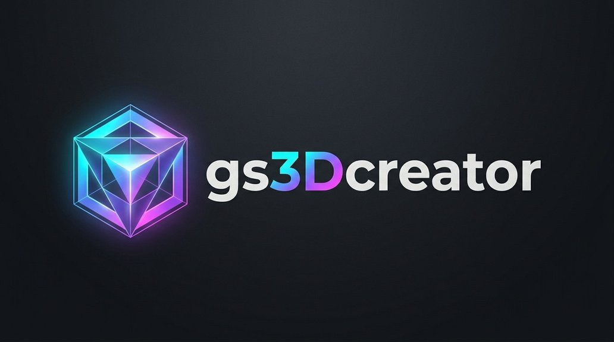

<p align="center">
  
</p>

<p align="center">
  <b>Découpe un modèle 3D en pièces imprimables, avec rotules, goujons ou tenons d’assemblage.</b><br>
  Rust · interface web locale avec aperçu 3D · paquets RPM et DEB
</p>

---

gs3Dcreator prend une figurine, une statue ou n’importe quel modèle trop grand pour ton
imprimante et la découpe en pièces qui s’impriment à plat, puis s’emboîtent. C’est
l’équivalent de la fonction « Impression par pièces » de Hi3D, sans passer des heures dans
Blender.

- **Gabarits de personnage** de 2 à 6 pièces (tête, bras, jambes, torse) : le cou, la
  taille, les hanches et les épaules sont détectés automatiquement par analyse des sections.
- **Plans de coupe libres** : déplace, incline ou trace une coupe directement sur le modèle;
  une coupe placée sur une pièce déjà détachée la recoupe (une botte, un avant-bras).
- **Connecteurs** : rotules (boules à base plate, imprimables sans support), goujons séparés,
  tenons intégrés, ou aucun (collage).
- **Export** : un STL par pièce posé sur sa plus grande face de coupe, un 3MF disposé sur le
  plateau, un ZIP de tout, et un aperçu GLB coloré.
- **Formats acceptés** : STL, OBJ, GLB/glTF, PLY, 3MF, OFF. Réparation automatique (sommets
  fusionnés, faces dégénérées, normales, petits trous).
- **Image → 3D** : transforme une photo ou une illustration en STL imprimable grâce à ton
  serveur d’IA local (Hunyuan3D-2, TripoSR, TRELLIS…). Un LLM vision (LM Studio, Ollama,
  OpenRouter…) peut vérifier l’image avant la génération.
- **Tout est local** : un seul binaire, aucune dépendance Python, aucun envoi vers Internet
  (three.js est intégré au binaire), sauf vers les fournisseurs d’IA que tu configures.

## Installation

Télécharge le paquet de la [dernière version](https://github.com/gsavard/gs3DCreator/releases/latest).

**Fedora, RHEL, openSUSE (RPM)**

```bash
sudo dnf install ./gs3dcreator-2.1.0-1.x86_64.rpm
```

**Debian, Ubuntu, Mint (DEB)**

```bash
sudo apt install ./gs3dcreator_2.1.0-1_amd64.deb
```

Cherche ensuite **gs3Dcreator** dans le menu des applications. Le binaire est compilé contre
la glibc de la machine de compilation; les paquets de la page des versions sont construits
sur Ubuntu 22.04 (glibc 2.35) et fonctionnent sur Fedora 36+, Debian 12+ et Ubuntu 22.04+.

**Désinstaller** : `sudo dnf remove gs3dcreator` ou `sudo apt remove gs3dcreator`.

## Utilisation

### Interface graphique

```bash
gs3dcreator            # ou le lanceur « gs3Dcreator » du menu
```

Le serveur démarre sur `http://127.0.0.1:8790` (ou un port libre si 8790 est pris) et
s’ouvre dans une fenêtre d’application Chrome/Chromium/Brave/Edge, sinon dans le navigateur
par défaut. Relancer l’application réutilise le serveur déjà démarré.

1. **Modèle** : dépose un fichier. Choisis l’axe vertical (Auto, Y pour les modèles générés
   par IA et les GLB, Z pour les STL de CAO) et la hauteur finale en mm.
2. **Gabarit** : choisis le nombre de pièces. Les plans proposés apparaissent en couleur.
3. **Coupes** : ajuste chaque plan (T = déplacer, R = incliner, D = tracer un trait),
   inverse le côté détaché, ajoute ou supprime des coupes.
4. **Assemblage** : type de connecteur, rayon et jeu, puis **Découper**. Télécharge le 3MF
   ou le ZIP des STL.

L’onglet **Image → 3D** génère un modèle à partir d’une image. Configure d’abord un
fournisseur avec le bouton ⚙ (voir [Image → 3D dans le guide](docs/GUIDE.md#9-image--3d)).

Le guide détaillé est dans [docs/GUIDE.md](docs/GUIDE.md).

### Ligne de commande

```bash
# Dimensions et étanchéité
gs3dcreator info figurine.stl

# Profil de sections (îlots et aires) pour repérer cou, taille, poignets…
gs3dcreator profil figurine.stl --axe z --pas 5

# Gabarit de personnage sans interface (repères automatiques)
gs3dcreator gabarit figurine.glb -g 6 --hauteur 180 -s sortie/

# Plans libres, goujons séparés
gs3dcreator decouper statue.stl -s sortie/ --plan z=95 --plan z=140

# Plan incliné (normale puis point), tenons intégrés
gs3dcreator decouper piece.stl -s sortie/ --plan "0,0.3,1,0,0,80" --connecteur tenon

# Découpe automatique jusqu'à entrer dans le volume d'impression
gs3dcreator decouper statue.stl -s sortie/ --auto --volume 220 220 250
```

| Commande | Rôle |
|---|---|
| `ouvrir` (défaut) | Démarre le serveur au besoin et ouvre l’interface |
| `serveur [--hote --port --ouvrir]` | Serveur web au premier plan (utile en SSH ou en service) |
| `arreter` | Arrête le serveur démarré par `ouvrir` |
| `info <modèle>` | Dimensions, nombre de triangles, étanchéité |
| `profil <modèle>` | Sections tranche par tranche le long d’un axe |
| `decouper <modèle>` | Coupes par plans et/ou automatiques au volume d’impression |
| `gabarit <modèle>` | Gabarit de personnage (6, 5, 4a, 4b, 3, 2) |

Options d’assemblage communes : `--connecteur rotule|goujon|tenon|aucun`, `--rayon`,
`--profondeur`, `--jeu`, `--paroi`, `--par-ilot 1|2`, `--volume X Y Z`.
`gs3dcreator <commande> --help` donne le détail.

## Compilation depuis les sources

Prérequis : Rust 1.85+, CMake 3.18+, un compilateur C++17 (g++ ou clang) et git. La
bibliothèque géométrique [Manifold](https://github.com/elalish/manifold) est compilée
automatiquement (la première compilation télécharge Clipper2 et prend quelques minutes).

```bash
# Fedora
sudo dnf install cargo rust cmake gcc-c++ git
# Debian / Ubuntu (Rust récent via rustup : https://rustup.rs)
sudo apt install cmake g++ git

git clone https://github.com/gsavard/gs3DCreator.git
cd gs3DCreator
cargo build --release
./target/release/gs3dcreator
```

### Construire les paquets RPM et DEB

```bash
cargo install cargo-deb cargo-generate-rpm
./scripts/paquets.sh          # → dist/*.rpm et dist/*.deb
```

Les versions publiées sont construites par GitHub Actions
([.github/workflows/release.yml](.github/workflows/release.yml)) à chaque étiquette `v*`.

## Architecture

| Fichier | Rôle |
|---|---|
| `src/main.rs` | Interface en ligne de commande (clap) |
| `src/lanceur.rs` | Instance unique, choix du port, ouverture du navigateur, arrêt |
| `src/serveur.rs` | API JSON (axum) et fichiers web intégrés au binaire |
| `src/moteur.rs` | Repères anatomiques, gabarits, coupes localisées, connecteurs, export |
| `src/cli.rs` | Coupes par plans, découpe automatique, profil |
| `src/sections.rs` | Sections 2D : îlots, pôle d’inaccessibilité, positions des connecteurs |
| `src/ia.rs` | Fournisseurs d’IA, génération image → 3D en tâche de fond, conversion en STL |
| `src/maillage.rs` | Import/export (STL, OBJ, glTF, PLY, 3MF, OFF), réparation, conversions Manifold |
| `web/` | Interface (HTML + three.js 0.160 intégré) |
| `packaging/` | Lanceur `.desktop`, métadonnées AppStream, page de manuel |

L’API est décrite dans [docs/API.md](docs/API.md).

## Historique

La version 1.x était écrite en Python (trimesh, manifold3d, shapely, FastAPI) et
s’installait dans un environnement virtuel. La 2.0 est une réécriture complète en Rust :
un seul binaire, démarrage instantané, mêmes algorithmes et mêmes résultats. Voir
[CHANGELOG.md](CHANGELOG.md).

## Licence

MIT — voir [LICENSE](LICENSE). three.js (MIT) et Manifold (Apache-2.0) sont distribués selon
leurs propres licences.
